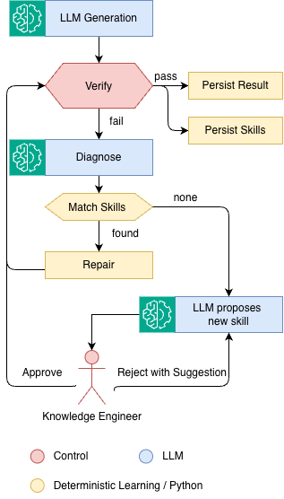

# [](https://doi.org/10.5281/zenodo.23287697)


# Verifier-Guided Repair of LLM-Generated TLA+ Specifications: A Skill-Mediated Agentic Loop for NASA DDMR-26

---

## Project Overview

This subproject implements a **skill-mediated, verifier-in-the-loop workflow** for repairing LLM-generated TLA+ specifications, as introduced and evaluated in the companion paper:

> **Lu, T. (2026)**. _Verifier-Guided Repair of LLM-Generated TLA+ Specifications: A Skill-Mediated Agentic Loop for NASA DDMR-26._ IEEE ETECOM 2026, Paris, France. arXiv: _(link added on announcement)_.

The workflow combines LLM-based generation from natural-language requirements with TLC model checking, a single bounded repair attempt guided by TLC diagnostics and reusable repair skills, and an architecture for human-approved synthesis of new repair skills. The reported study is a **pilot**: one requirement, one LLM (GPT-4o), one repair attempt, a persistent order-dependent skill registry, and no no-skill control.

Generated modules and configurations, TLC logs of failing attempts, run metadata, prompt templates, the final skill registry, and the re-scoring script with per-trial results are released (see also the [Zenodo archive](https://doi.org/10.5281/zenodo.23287697)). Rendered per-trial prompts, LLM sampling seeds and human approval decisions were **not** recorded for the reported run.

---

## Verifier-in-the-Loop Architecture & Principles

- **Skill-mediated, TLC-gated repair**
  - TLC acts as a gate: initially passing specifications terminate unchanged; failing specifications receive one repair attempt, guided by the TLC diagnostic and a matching skill from the registry.
  - Unrecognized diagnostics trigger an LLM-generated skill proposal that a human must approve or reject (with a suggestion). An approved skill enters the persistent registry at approval, whether or not the repair succeeds.
  - Because initially passing specifications never enter repair, repair cannot regress them. This is a property of the control flow, not an empirical result about repair quality.
  - No model-parameter update or policy learning takes place.

- **Conditional workflow and experimental pairing**
  - Baseline and repair arms use the identical initial LLM-generated specification for each trial; only the subsequent repair differs.
  - The registry is not reset between trials, so trials are order-dependent and not statistically independent.

- **Modularity**
  - Each repair skill addresses a single error type or root cause per attempt.



---

## Key Experimental Results (NASA DDMR-26, N=100)

Two deliberately weak criteria are reported:

- **Executable pass (EP):** TLC accepts the module and completes exploration under the configuration generated by the pipeline.
- **Property pass (PP):** an EP-passing module additionally satisfies its own `TypeOK` and `DDMR26` under a fixed configuration (`SPECIFICATION Spec`, `INVARIANTS TypeOK DDMR26`, `CHECK_DEADLOCK FALSE`, `CONSTANT N = 3`).

Neither criterion establishes semantic faithfulness to the natural-language requirement.

| Criterion | Initial | Rescued (of 80) | Final | CRSR  |
|-----------|:-------:|:---------------:|:-----:|:-----:|
| EP        |   20    |       68        |  88   | 85.0% |
| PP        |   19    |       56        |  75   | 70.0% |

- The pipeline's generated TLC configurations omitted the encoded invariants in 87 of the 88 EP-passing runs, so EP does not imply that `TypeOK` or `DDMR26` was checked. PP re-scores the saved modules; it did not guide the loop. Per-trial results: [`rescoring_passes.csv`](rescoring_passes.csv).
- 12 of the 68 EP rescues (and initially passing trial 94) violate `DDMR26`; `TypeOK` is never violated.
- No significance test or confidence interval is reported, because the persistent registry makes trials order-dependent.

#### Trial-Level Rescue by First Matched Skill (80 repair trials)

| Skill (first diagnostic)              | Trials | EP | PP |
|---------------------------------------|:------:|:--:|:--:|
| Unknown operator (`GENERIC_FN`)       |   45   | 40 | 34 |
| Missing next-state assignment         |   27   | 27 | 21 |
| IF/THEN/ELSE parse error              |    4   |  0 |  0 |
| Boolean evaluation                    |    3   |  0 |  0 |
| Incorrect function syntax             |    1   |  1 |  1 |
| **Total**                             | **80** | **68** | **56** |

All 80 first diagnostics matched a skill present in the final 17-skill registry; five skills fired and twelve were never triggered. Skill synthesis and human approval were therefore not exercised in this run, and without a no-skill control the rescues cannot be attributed to the skills. Further output tables are in [`results/`](results/).

---

## Main Method: Summary

1. **Paired LLM Generation:** For each trial, the natural-language requirement (NASA DDMR-26) is converted to TLA+ by the LLM using a domain-engineered scaffold; the same initial specification is used for both arms.
2. **Baseline Verification:** TLC checks the specification under the pipeline-generated configuration. If it passes, the specification is kept unchanged.
3. **Conditional Repair:** If TLC fails, the diagnostic is matched to a registry skill and the LLM regenerates the module once, using the TLC output and the skill. Unmatched diagnostics trigger an LLM skill proposal that requires explicit human approval.
4. **Iteration Limit:** At most two attempts per trial: the initial generation and one repair (`max_iterations=2`).
5. **Re-scoring:** Saved passing modules are re-checked against `TypeOK` and `DDMR26` (PP) with the released re-scoring script.

---

## Usage & Reproducing the Experiment

The workflow supports both _live LLM_ (e.g., OpenAI GPT-4o) and _replay_ (cached-output) runs. Live runs are not deterministic even at temperature 0, so they will not reproduce the reported numbers exactly; replay re-executes the saved outputs.

### Example CLI Run (100 trials, live LLM)
```sh
cd agentic_loop
source .venv/bin/activate
PYTHONPATH=src python -m agentic_loop.compare_cli \
  --task tasks/nasa_ddmr26_sample.yaml \
  --tla-jar tla/tla2tools.jar \
  --module-dir tla \
  --prompts-dir prompts \
  --prompt-mode one_shot \
  --max-iterations 2 \
  --provider openai \
  --model gpt-4o \
  --output-dir results/comparison \
  --num-trials 100
```

### Exact Replay (reproducibility/audit)
```sh
PYTHONPATH=src python -m agentic_loop.compare_cli \
  ... \
  --provider replay \
  --replay-dir replay_outputs
```

#### Output Structure:
- Trial-by-trial metrics in `results/comparison/<taskname>/baseline/` and `.../loop/`, plus [`rescoring_passes.csv`](rescoring_passes.csv) with the per-trial re-scoring results.

#### Requirements
- `tla2tools.jar`, domain scaffold files (`CLA_Generated.tla`, `CLA_generation_eval.cfg`, etc.) must be available in `tla/`.
- All commands are run from `/agentic_loop/`.

---

## Implementation Highlights

- Paired baseline/repair experiment control with result logging
- Modular skill-based repair with an architecture for _human-in-the-loop approval_ of newly synthesized skills
- TLC as the executable verification signal for loop gating
- One bounded repair attempt per trial
- Released artifacts: generated modules and configurations, TLC logs of failing attempts, run metadata, final skill registry, re-scoring script and results (CSV, JSON, Markdown)


---

## 📚 Publication & Citation

This repository accompanies:

**Lu, T. (2026).** _Verifier-Guided Repair of LLM-Generated TLA+ Specifications: A Skill-Mediated Agentic Loop for NASA DDMR-26_. In: _2026 IEEE International Conference on Emerging Trends in Engineering and Computing (ETECOM)_, Paris, France, 26–27 October 2026. To appear in IEEE Xplore.

```bibtex
@inproceedings{lu2026verifier,
  author    = {Lu, Tianxiang},
  title     = {Verifier-Guided Repair of {LLM}-Generated {TLA+} Specifications: A Skill-Mediated Agentic Loop for {NASA DDMR-26}},
  booktitle = {2026 IEEE International Conference on Emerging Trends in Engineering and Computing (ETECOM)},
  year      = {2026},
  address   = {Paris, France},
  month     = oct,
  note      = {to appear in IEEE Xplore}
}
```
